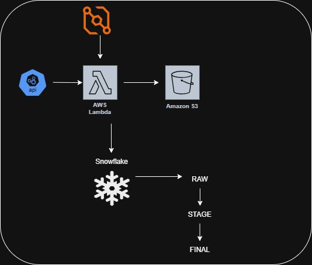

# Currency Exchange Rate Pipeline

A serverless ETL pipeline that fetches real-time currency exchange rates from
the [Open Exchange Rates](https://openexchangerates.org/) API on a schedule,
lands the raw payload in S3, and loads it into a curated Snowflake table.

```
EventBridge ──▶ Lambda ──▶ Open Exchange Rates API
                  │
                  ├──▶ S3  (raw JSON, partitioned by yyyy/mm/dd/hh)
                  │
                  └──▶ Snowflake  (RAW → STG → curated via stored procedure)
```



## Components

| Component             | Purpose                                                        |
| --------------------- | -------------------------------------------------------------- |
| **EventBridge rule**  | Cron trigger that invokes the Lambda on a schedule             |
| **Lambda function**   | Fetches the API, writes JSON to S3, calls the Snowflake proc   |
| **S3 bucket**         | Immutable raw landing zone (`exchange_rates/yyyy/mm/dd/`)      |
| **Secrets Manager**   | Stores Snowflake credentials and the OER API key               |
| **Snowflake**         | `RAW` → `STG` → `EXCHANGE_RATES` via `SP_EXCHANGE_RATE_LOADING`|

## Repository layout

```
.
├── .env.example                # Template for Lambda env vars (no secrets)
├── .gitignore
├── LICENSE
├── README.md
├── requirements.txt            # Python dependencies for the Lambda layer
├── docs/
│   ├── architecture.jpg        # Diagram (also embedded above)
│   ├── conventions.md          # AWS / Snowflake naming conventions
│   ├── iam-roles.md            # Minimum-privilege IAM policies
│   └── secrets-manager.md      # Secret name + JSON shape
├── layers/
│   └── README.md               # How to build the Snowflake Lambda layer
│                               #   (zips are .gitignored — rebuild locally)
├── sql/
│   └── snowflake_setup.sql     # DB / schema / tables / stored procedure
└── src/
    ├── lambda_function.py      # Lambda entry point (lambda_handler)
    └── snowflake_provider.py   # Secrets Manager + Snowflake connector wrapper
```

## Prerequisites

- AWS account with permissions to create Lambda, IAM, S3, EventBridge, and
  Secrets Manager resources.
- A Snowflake account that can create databases, schemas, tables, and
  procedures.
- An Open Exchange Rates API key — sign up at
  <https://openexchangerates.org/>.
- Python 3.9 or newer (matching the Lambda runtime).

## Setup

### 1. Snowflake

Run [`sql/snowflake_setup.sql`](sql/snowflake_setup.sql). It creates:

- Database `CURRENCY_DB` and schema `CURRENCY`
- Tables `EXCHANGE_RATES_RAW`, `EXCHANGE_RATES_STG`, `EXCHANGE_RATES`
- Stored procedure `SP_EXCHANGE_RATE_LOADING(p_json_data, p_datetime)`

### 2. AWS Secrets Manager

Create a secret named `db/currency-exchange-rate` using the JSON shape in
[`docs/secrets-manager.md`](docs/secrets-manager.md).

### 3. AWS S3

Create the raw-data bucket (default name: `s3-currency-exchange-rate-qh` —
update [`.env.example`](.env.example) if you choose a different one).

### 4. Lambda layer

The `snowflake-connector-python` package is too large to inline. Build it as a
Lambda layer per [`layers/README.md`](layers/README.md) and attach the
published version to the function.

### 5. Lambda function

1. Create the function `fn-currency-exchange-rate-qh` (Python 3.9+).
2. Upload the contents of [`src/`](src/) (both `lambda_function.py` and
   `snowflake_provider.py`).
3. Set the handler to `lambda_function.lambda_handler`.
4. Attach the Snowflake layer from step 4.
5. Set environment variables — see [`.env.example`](.env.example).
6. Attach the execution role from
   [`docs/iam-roles.md`](docs/iam-roles.md).

### 6. EventBridge rule

Create rule `rule-currency-exchange-rate-qh` with the desired schedule
expression (e.g. `rate(1 hour)` or `cron(0 * * * ? *)`) and target the
Lambda function.

## How it works

1. EventBridge invokes the Lambda on schedule.
2. The handler calls `GET {oer_base_url}?app_id=...&base=USD`.
3. The full JSON response is written to
   `s3://<bucket>/exchange_rates/{yyyy}/{mm}/{dd}/exchange-rates-{hh}.json`.
4. The handler invokes `CURRENCY.SP_EXCHANGE_RATE_LOADING(json, ts)` in
   Snowflake. The procedure:
   - Truncates `EXCHANGE_RATES_RAW` and inserts the JSON + timestamp.
   - Truncates `EXCHANGE_RATES_STG` and flattens `rates` into rows.
   - `MERGE`s new rows into the curated `EXCHANGE_RATES` table on
     `(timestamp_utc, base_currency, target_currency)`.

## Local development

```bash
python -m venv .venv
source .venv/bin/activate          # Windows: .venv\Scripts\activate
pip install -r requirements.txt
cp .env.example .env                # then fill in real values (do NOT commit)
```

`.env` is gitignored. AWS credentials should come from your standard provider
chain (e.g. `aws configure` or SSO), not from this repo.

## Security checklist

- [x] No real credentials in the repo — only `.env.example` placeholders.
- [x] `.env`, `*.zip`, `secrets/`, key material, and `layers/*` are gitignored.
- [x] Snowflake credentials live in Secrets Manager, not env vars.
- [ ] Replace `ACCOUNTADMIN` with a least-privilege Snowflake role for the
      pipeline before going to production.
- [ ] Scope the Lambda IAM role to the specific S3 bucket and secret ARN
      (sample policy in [`docs/iam-roles.md`](docs/iam-roles.md)).

## Monitoring

- **CloudWatch Logs** — Lambda execution and error traces.
- **CloudWatch Metrics** — invocation count, duration, error rate.
- **Snowflake QUERY_HISTORY** — verify the stored proc runs and merge counts.

## License

Released under the [MIT License](LICENSE).

## Contributing

1. Fork the repository.
2. Create a feature branch.
3. Commit your changes.
4. Push to the branch.
5. Open a Pull Request.
